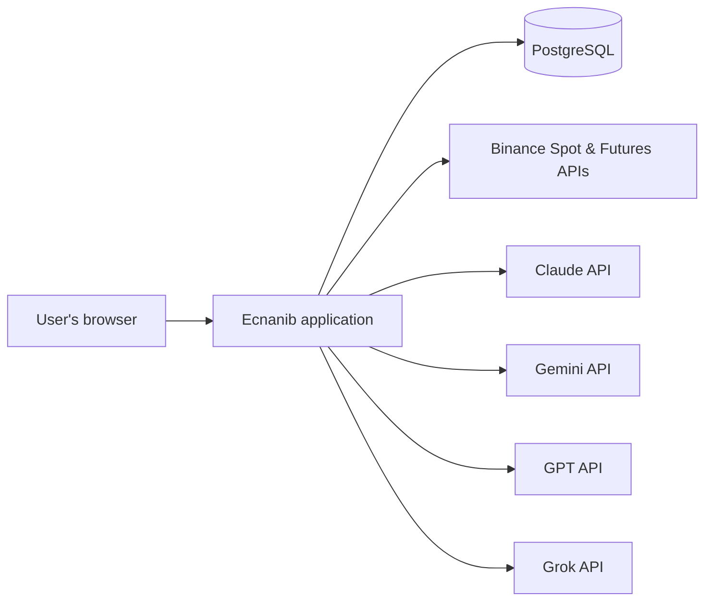
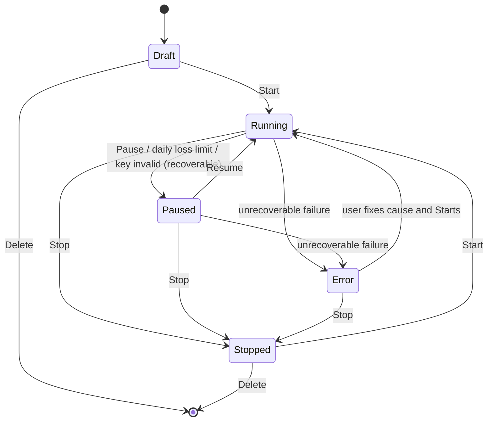

# Ecnanib — Software Requirements Specification

| Field | Value |
|---|---|
| Product | **Ecnanib** — AI Cryptocurrency Trading Agents |
| Document | Software Requirements Specification (SRS) |
| Version | 0.1 (Draft) |
| Date | 2026-10-18 |
| Status | For review |

---

## 1. Introduction

### 1.1 Purpose

This document specifies the functional and non-functional requirements for **Ecnanib**, a free, software-as-a-service platform on which users create and run AI-assisted cryptocurrency trading agents against Binance Spot and Futures markets.

It is written for the product owner, designers, developers and testers and is intended to be the single source of truth for *what* the system must do. It deliberately does **not** prescribe a technology stack. Languages, frameworks, libraries, hosting and tooling are left to the design phase, except for the owner-mandated constraints listed in §2.5.

### 1.2 Scope

**In scope**

- User accounts (free, no subscription, no organizations/tenants).
- Bring-your-own-key (BYOK) management for Binance and for four AI providers.
- Creation and unattended operation of trading agents on Binance **Spot** and **USDT-margined Futures**.
- Agent-level selection of one timeframe (15m, 1H, 4H or 1D), with a strategy catalog that differs per timeframe.
- A multi-model "council" in which Claude, Gemini, GPT and Grok cooperate, each assigned a role matching its observed strength, with provider and model selectable per role at agent level.
- Syncing of available models from each provider.
- Tracking of each provider's and model's trading experience and feeding it back into decisions.
- Paper and live trading, with Binance testnet support.
- A web user interface with dark/light/system theme and purposeful animation.
- Logging to console and database.
- Configuration through the hosting framework's standard sources: one configuration file with an optional environment overlay, environment variables and the command line.

**Out of scope (v1)**

- Payments, billing, plans, subscriptions, trials.
- Multi-tenancy: organizations, teams, workspaces, resource sharing.
- Exchanges other than Binance; markets other than Spot and USDT-M Futures (no COIN-M, options, margin).
- Backtesting against historical data (paper mode is the validation path in v1).
- Notifications by email, chat or push.
- Native mobile applications.
- High availability / multi-instance deployment.

### 1.3 Definitions

| Term | Meaning |
|---|---|
| **Agent** | A user-owned, server-side process configuration that trades one symbol on one market at one timeframe with one strategy and one council configuration. |
| **Council** | The set of AI roles an agent consults at each evaluation. |
| **Role** | A named responsibility within the council (Market Analyst, Sentiment & Flow, Cross-Market Context, Risk Manager). |
| **Provider** | An AI vendor: Anthropic (Claude), Google (Gemini), OpenAI (GPT), xAI (Grok). |
| **Model** | A specific model identifier offered by a provider. |
| **BYOK** | Bring Your Own Key: all exchange and provider credentials are supplied by the user. The system holds none of its own. |
| **Timeframe** | Candle interval on which an agent evaluates: 15m, 1H, 4H or 1D. |
| **Strategy** | A deterministic, rules-based method that produces bias, levels and candidate setups for a timeframe. |
| **Setup** | A strategy-detected trade candidate with proposed entry, stop and target. |
| **Candle close** | The UTC-aligned end of a timeframe interval; the moment an agent evaluates. |
| **Paper mode** | Agent mode in which no exchange orders are sent; fills are simulated against live prices. |
| **Live mode** | Agent mode in which orders are sent to Binance (production or testnet, per the key used). |
| **Experience** | Recorded decisions and outcomes attributed to a provider, model and role. |
| **R** | Risk unit: the distance from entry to initial stop. A 2R target is twice that distance. |
| **ATR / EMA / VWAP** | Average True Range / Exponential Moving Average / Volume-Weighted Average Price. |
| **HTF** | Higher timeframe used for directional bias. |
| **OCO** | One-Cancels-the-Other order pair (take-profit + stop) on Spot. |
| **Reduce-only** | Futures order flag ensuring an order can only reduce a position. |
| **Operator** | The person who deploys and configures the system. Not an application role. |

### 1.4 Conventions

- **SHALL** = mandatory; **SHOULD** = strongly recommended; **MAY** = optional.
- Requirement identifiers: `FR-<GROUP>-<nn>` (functional), `NFR-<GROUP>-<nn>` (non-functional).
- All times are UTC unless stated otherwise.

---

## 2. Overall Description

### 2.1 Product Perspective

Ecnanib is a self-contained web application with one database and five external dependencies.

All calls to Binance and to the AI providers are made with the keys of the user who owns the agent making the call. Public Binance market data (candles, tickers, exchange information) requires no key.

### 2.2 Product Functions (summary)

1. Register, sign in, manage profile, delete account.
2. Add, validate, rotate and remove Binance and AI-provider keys.
3. Create agents: market, symbol, timeframe, strategy and parameters, council assignment, risk limits, mode.
4. Run agents unattended: evaluate at every candle close, consult the council, enforce risk limits, execute and manage positions.
5. Sync provider model catalogs and keep agents pointed at valid models.
6. Record every decision and outcome; compute provider/model/role experience; feed it back into prompts and show it in the UI.
7. Observe everything in a themed, animated dashboard with live updates.
8. Log to console and database with retention.

### 2.3 User Classes

| Class | Description |
|---|---|
| **Visitor** | Unauthenticated. Can view the landing page and sign up / sign in. |
| **User** | Authenticated. Owns keys, agents, decisions and logs. All users have identical capabilities; there are no plans or privilege levels. |
| **Operator** | Deploys the application, edits the configuration file, reads console output and the database. Has no in-app privileges. |

### 2.4 Operating Environment

- One application process serving the web UI, the API and the agent runtime.
- One PostgreSQL database.
- Outbound internet access to Binance and the four provider APIs.
- Users access the UI from current desktop and mobile browsers.

### 2.5 Design and Implementation Constraints (owner-mandated)

| ID | Constraint |
|---|---|
| C-01 | Product name is **Ecnanib**. |
| C-02 | Exchange is Binance only: Spot and USDT-margined Futures. |
| C-03 | Agent timeframe is exactly one of 15m, 1H, 4H, 1D, selected per agent; strategies differ per timeframe. |
| C-04 | Supported providers are Claude, Gemini, GPT and Grok; they work together with roles assigned by strength; provider and model are selected per agent. |
| C-05 | BYOK: the system holds no exchange or provider credentials of its own. |
| C-06 | UI theme: dark, light and system; system by default. |
| C-07 | UI uses animation. |
| C-08 | Logging goes to console **and** database. |
| C-09 | Database is PostgreSQL; schema migrations are applied automatically at startup; no table partitioning; all data access goes through an ORM. |
| C-10 | Simple architecture: one deployable application and one database; no message brokers, queues, caches or separate services. |
| C-11 | Configuration through the hosting framework's standard sources: a configuration file at a documented default path, an optional environment overlay, environment variables and the command line. No secrets held by the system, no vault or secret manager. |
| C-12 | Free software-as-a-service: no subscriptions, no billing, no tenants; there are users. |
| C-13 | This SRS does not prescribe a technology stack beyond C-09. |

### 2.6 Assumptions and Interpretations

| ID | Assumption / interpretation |
|---|---|
| A-01 | "No secret" means the system owns no API keys or tokens. The configuration file contains no credentials other than the database connection. Any key the system needs internally (e.g., for signing sessions) is generated on first start and stored in the database. |
| A-02 | User-supplied keys are stored in the database. Because C-11 forbids an external key store, encryption at rest with a key held outside the database is not provided; protection relies on database access control, transport security, masking and strict non-logging (see FR-KEY, NFR-SEC). This is a deliberate owner decision and is recorded as a risk in Appendix F. |
| A-03 | "Provider models syncing" means fetching each provider's list of available models through its API and keeping a catalog current. |
| A-04 | "Providers trading experience" means recording decisions and outcomes per provider/model/role and feeding that history back into both the UI and the models' prompts. |
| A-05 | "Work together role by strength" means a sequential council with default role assignments based on observed tendencies (Appendix B). Defaults are editable; they are starting points, not guarantees of performance. |
| A-06 | Futures agents operate in one-way position mode. Hedge mode is unsupported in v1. |
| A-07 | Each agent trades exactly one symbol. |
| A-08 | Users are responsible for the legality of using Binance and the providers in their jurisdiction and for their own taxes. |
| A-09 | No outbound email is required; account registration does not depend on email verification in v1. |
| A-10 | The Binance Spot and Futures testnets are available for live-mode testing. |

---

## 3. Specific Requirements

### 3.1 External Interface Requirements

#### 3.1.1 User Interface

- UI-01 The system SHALL provide a browser-based interface with the pages listed in FR-UI-01.
- UI-02 The interface SHALL be responsive for desktop and mobile widths.
- UI-03 The interface SHALL support dark, light and system themes (FR-UI-02).
- UI-04 The interface SHALL use animation as specified in FR-UI-03 and SHALL honor reduced-motion preferences.

#### 3.1.2 Exchange Interface (Binance)

- EX-01 The system SHALL use the Binance Spot API for spot market data, account and orders.
- EX-02 The system SHALL use the Binance USDT-M Futures API for futures market data, account, position settings and orders.
- EX-03 The system SHALL use the exchanges' streaming interfaces for live candle, price and user-data updates, with REST polling as fallback.
- EX-04 The system SHALL support both production and testnet environments, selected per exchange key.
- EX-05 The system SHALL respect published request-weight and order-rate limits and back off on rate-limit responses.
- EX-06 Public market data SHALL be retrieved without user keys.

#### 3.1.3 AI Provider Interfaces

- AI-01 The system SHALL integrate with the APIs of Anthropic (Claude), Google (Gemini), OpenAI (GPT) and xAI (Grok).
- AI-02 For each provider the system SHALL support: listing available models; sending a role prompt and receiving a response; requesting structured output where the provider supports it.
- AI-03 All provider calls SHALL use the key of the user who owns the agent.
- AI-04 The system SHALL record token usage reported by the provider for each call.

#### 3.1.4 Database Interface

- DB-01 The system SHALL use a single PostgreSQL database accessed exclusively through an ORM.
- DB-02 Schema migrations SHALL be versioned, forward-only and applied automatically at application startup.
- DB-03 No table SHALL be partitioned.

### 3.2 Functional Requirements

#### FR-ACC — Accounts and Access

- FR-ACC-01 The system SHALL allow a visitor to register with an email address and password.
- FR-ACC-02 The system SHALL allow a user to sign in, stay signed in across sessions, and sign out.
- FR-ACC-03 The system SHALL allow a user to change their password.
- FR-ACC-04 The system SHALL allow a user to delete their account after explicit confirmation. Deletion SHALL require all of the user's agents to be in the Stopped or Draft state and SHALL remove the user's keys, agents, decisions, trades and logs.
- FR-ACC-05 The system SHALL contain no payment, billing, plan, subscription, trial or quota-by-payment concept.
- FR-ACC-06 The system SHALL contain no organization, team, workspace or tenant concept. Every resource belongs to exactly one user and cannot be shared, transferred or delegated.
- FR-ACC-07 The system SHALL enforce fair-use limits defined in the configuration file (e.g., maximum agents per user, maximum running agents per user). These limits are identical for all users.
- FR-ACC-08 Before a user starts their first live-mode agent, the system SHALL require the user to read and accept a risk disclaimer, and SHALL record the acceptance with a timestamp.

#### FR-KEY — Bring Your Own Key

- FR-KEY-01 The system SHALL allow a user to add one or more Binance API key pairs, each with a label, an environment (production or testnet) and the markets it may be used for (spot, futures, or both).
- FR-KEY-02 On save, the system SHALL validate a Binance key by making an authenticated request and SHALL read the key's permissions. The system SHALL refuse to store a key that has withdrawal permission enabled and SHALL tell the user why.
- FR-KEY-03 The system SHALL allow a user to add one key per AI provider (Claude, Gemini, GPT, Grok). On save, the system SHALL validate the key by listing the provider's models.
- FR-KEY-04 Keys SHALL be stored in the database bound to the owning user. The UI SHALL display keys masked (at most the last four characters). Key values SHALL never be written to logs, error messages, prompts or the UI after entry.
- FR-KEY-05 A key SHALL be transmitted only to the service it belongs to (Binance, or the specific provider). Keys SHALL never be included in prompts sent to any provider.
- FR-KEY-06 The system SHALL allow a user to replace or delete a key. Deleting a key in use by a Running or Paused agent SHALL require the user to stop that agent first, or SHALL stop it as part of a confirmed cascade.
- FR-KEY-07 The system SHALL periodically re-validate stored keys. If a key becomes invalid, agents using it SHALL enter the Error state, SHALL not open new positions, and the UI SHALL show the cause.
- FR-KEY-08 The system SHALL hold no exchange or provider credentials of its own. Any feature that needs a key the user has not provided SHALL be unavailable to that user and clearly indicated as such.
- FR-KEY-09 Paper-mode agents SHALL NOT require an exchange key.

#### FR-CFG — System Configuration

- FR-CFG-01 All system configuration SHALL reside in the hosting framework's standard configuration file, `appsettings.json` in the working directory, optionally overlaid by `appsettings.{Environment}.json`.
- FR-CFG-02 The system SHALL read configuration only through the hosting framework's standard sources and in its standard precedence (the file, the environment overlay, environment variables, command-line arguments) and SHALL add no source of its own.
- FR-CFG-03 The configuration file SHALL contain no API keys, tokens or other credentials except the database connection.
- FR-CFG-04 The system SHALL NOT integrate with any external secret manager or vault.
- FR-CFG-05 Any key the system needs for its own operation (e.g., session signing) SHALL be generated automatically on first start and stored in the database.
- FR-CFG-06 The system SHALL validate the configuration file at startup and SHALL refuse to start with a clear console error if it is invalid.
- FR-CFG-07 Configuration changes SHALL take effect on restart. Hot reload MAY be supported.
- FR-CFG-08 The configuration file SHALL cover at least the sections listed in Appendix D.

#### FR-AGT — Agents

- FR-AGT-01 The system SHALL allow a user to create an agent with: name; market type (spot or futures); symbol; timeframe; strategy and its parameters; council assignment; risk limits; mode (paper or live); exchange key (live only); and, for futures, leverage and margin mode.
- FR-AGT-02 The timeframe SHALL be exactly one of 15m, 1H, 4H, 1D.
- FR-AGT-03 The strategy choices offered SHALL be filtered by the selected timeframe. Each timeframe SHALL have at least one strategy, as defined in Appendix A.
- FR-AGT-04 Agents SHALL follow the lifecycle in Appendix E with user actions Start, Pause, Resume, Stop, Delete and Clone.
- FR-AGT-05 A Paused agent SHALL NOT open new positions but SHALL continue to manage open positions and protective orders.
- FR-AGT-06 On Stop, the system SHALL cancel the agent's open orders and SHALL ask the user whether to close open positions at market or leave them. Positions left open SHALL be flagged as unmanaged in the UI.
- FR-AGT-07 Timeframe, market, symbol and mode SHALL be editable only in Draft or Stopped state. Strategy parameters, council assignment and risk limits SHALL be editable in Paused state and take effect at the next evaluation. All edits SHALL be recorded in an agent change history.
- FR-AGT-08 Agents SHALL run server-side and continue to operate while the user is offline.
- FR-AGT-09 Each Running or Paused agent SHALL be evaluated exactly once per candle close of its timeframe, aligned to UTC interval boundaries. Repeated or restarted evaluations for the same candle SHALL be idempotent.
- FR-AGT-10 The evaluation pipeline SHALL be: load market data → run strategy engine → decide whether the council is needed (FR-AI-08) → run council → apply hard risk limits → execute → persist decision, orders and state → log → notify UI.
- FR-AGT-11 Paper mode SHALL simulate fills against live prices: market entries at the next available price; limit entries when the limit price is traded through; stops and targets when the respective price is traded. Simulated fees and slippage SHALL use rates defined in the configuration file.
- FR-AGT-12 Spot agents SHALL be long-only. Futures agents MAY be long or short.
- FR-AGT-13 Futures agents SHALL use one-way position mode and SHALL default to isolated margin. Leverage SHALL not exceed the cap in the configuration file.
- FR-AGT-14 Each agent SHALL have a hard cap on simultaneously open positions (default 1).
- FR-AGT-15 The system SHALL enforce the per-user agent limits from the configuration file at creation and start time.

#### FR-STR — Timeframes and Strategies

- FR-STR-01 The strategy engine SHALL be deterministic: given the same candles and parameters it SHALL produce the same output.
- FR-STR-02 For each evaluation the engine SHALL output: higher-timeframe bias (long, short or none); key levels; indicator values; whether a candidate setup exists; and for a candidate, proposed entry, initial stop, target(s), invalidation condition and the filters applied.
- FR-STR-03 The engine SHALL obtain the higher-timeframe candles each strategy needs (4H for 15m strategies, 1D for 1H strategies, 1W and 1D for 4H and 1D strategies).
- FR-STR-04 Strategy parameters SHALL be editable per agent within bounds defined per parameter and SHALL be resettable to defaults. Defaults are given in Appendix A.
- FR-STR-05 Each agent SHALL support "no new entry" windows: recurring weekly windows (e.g., weekends) and one-off windows (e.g., scheduled macro events) in UTC.
- FR-STR-06 Each strategy in the catalog SHALL carry a version. An agent SHALL pin the version it was created with; the user MAY upgrade an agent to a newer version while it is Paused or Stopped.
- FR-STR-07 Short setups SHALL mirror long rules. Spot agents SHALL ignore short setups.

#### FR-AI — AI Council

- FR-AI-01 The system SHALL support Claude, Gemini, GPT and Grok as council members.
- FR-AI-02 The council SHALL consist of the roles defined in Appendix B, executed in the order given there. The Risk Manager role SHALL always run last and SHALL be the only role that can produce a final decision.
- FR-AI-03 For each role, the user SHALL select a provider and a model at agent level from the synced catalog (FR-SYNC) or by entering a model identifier manually. The same provider or model MAY be assigned to several roles.
- FR-AI-04 The system SHALL offer default assignments by strength (Appendix B) and SHALL also offer a single-model mode in which one chosen model performs all roles in sequence.
- FR-AI-05 Non-final roles MAY be disabled per agent. The Risk Manager role SHALL NOT be disabled.
- FR-AI-06 Each role SHALL receive: its role instructions; the agent configuration (market, symbol, timeframe, strategy, risk limits); the strategy engine output; a compact summary of recent candles; the current position and open orders; the experience summary for that provider/model/role (FR-EXP-06); and the outputs of preceding roles. Prompts SHALL never contain keys.
- FR-AI-07 Each role SHALL return a structured output matching the schema in Appendix C. The system SHALL validate the output; on failure it SHALL retry once and then treat the role as failed.
- FR-AI-08 To limit cost, the council SHALL be consulted only when at least one of the following holds: the strategy reports a candidate setup; the agent has an open position; discretionary mode is enabled. Otherwise the evaluation SHALL end after the strategy engine with a "no action" record.
- FR-AI-09 Discretionary mode (default off) SHALL allow the council to propose an entry without a strategy setup. Such proposals remain subject to all hard limits and SHALL include a stop.
- FR-AI-10 The Risk Manager's final decision SHALL be one of: open long, open short, hold, modify (tighten stop, take partial, update target), close, or no trade, together with size, prices and a short rationale.
- FR-AI-11 After the council, the system SHALL independently enforce the hard limits in FR-EXE-04 and FR-EXE-09 regardless of any council output. A decision that violates a limit SHALL be clamped where possible (e.g., size reduced) or rejected and logged.
- FR-AI-12 If a non-final role fails or times out, the pipeline SHALL continue without it and SHALL note the omission in the decision record. If the Risk Manager role fails or times out, no new position SHALL be opened and existing protective orders SHALL remain in place.
- FR-AI-13 Provider calls SHALL have a per-call timeout and a per-evaluation deadline (NFR-PERF-01). Rate-limit and transient errors SHALL be retried with backoff within the deadline.
- FR-AI-14 The full deliberation (each role's input summary, output, provider, model, latency and tokens) SHALL be persisted and viewable by the user.
- FR-AI-15 Decisions for open positions SHALL never widen a stop. Stops MAY only be tightened.

#### FR-SYNC — Provider Model Syncing

- FR-SYNC-01 The system SHALL maintain a model catalog per provider with: model identifier, display name, first seen, last seen, status (available or deprecated), and any capability metadata the provider returns.
- FR-SYNC-02 Catalog sync SHALL run: when a user adds or validates a provider key; periodically at the interval set in the configuration file, using any valid stored key for that provider; and on demand when a user requests it.
- FR-SYNC-03 A model absent from a configurable number of consecutive syncs SHALL be marked deprecated. Agents referencing a deprecated model SHALL show a warning and the user SHALL be prompted to choose a replacement.
- FR-SYNC-04 If a provider rejects a model identifier at call time, the agent SHALL enter the Error state with a message naming the model and role.
- FR-SYNC-05 The system SHALL contain no hard-coded model identifiers. Suggested defaults per provider SHALL be derived from the catalog (e.g., the most recently added generally available model) and from experience (FR-EXP-08).
- FR-SYNC-06 The UI SHALL show, per provider, the last sync time, result and model count.

#### FR-EXP — Provider Trading Experience

- FR-EXP-01 Every council decision SHALL be recorded with the provider, model and role that produced each part of it.
- FR-EXP-02 Every trade SHALL be linked to the decision chain that opened and managed it, and its outcome SHALL be recorded: realized P&L, R multiple, fees, funding (futures), duration, maximum adverse and favorable excursion.
- FR-EXP-03 For setups the council rejected or the Risk Manager vetoed, the system SHOULD compute a shadow outcome using the strategy's proposed stop and target, so that rejections can be evaluated.
- FR-EXP-04 The system SHALL compute experience statistics per provider, model, role, timeframe and market type: decisions, approvals, rejections, win rate, average R, expectancy, profit factor, contribution to drawdown, adherence to limits (how often outputs needed clamping), failure rate and average latency.
- FR-EXP-05 Statistics SHALL be available at three scopes: per agent, per user, and system-wide aggregate. The system-wide aggregate SHALL contain counts and ratios only and SHALL NOT expose any user, agent, symbol-level trade or key.
- FR-EXP-06 Each role prompt SHALL include a compact experience summary for that provider/model/role: recent outcomes and the headline statistics for the agent's timeframe and market type.
- FR-EXP-07 The UI SHALL present a provider/model leaderboard filterable by role, timeframe and market type, and a detail view per provider.
- FR-EXP-08 When a user creates an agent, the system SHOULD suggest, per role, the provider/model with the best expectancy in the user's own history for that role and timeframe, falling back to the defaults in Appendix B.

#### FR-DATA — Market Data

- FR-DATA-01 The system SHALL load tradable symbols and their trading filters (tick size, lot size, minimum notional) from the exchange and SHALL refresh them at least daily.
- FR-DATA-02 On agent start the system SHALL backfill the number of candles set in the configuration file for the agent's timeframe and its higher timeframes.
- FR-DATA-03 The system SHALL receive candle closes through the exchange's streaming interface and SHALL fall back to polling if the stream is unavailable. Streams SHALL reconnect automatically.
- FR-DATA-04 For futures symbols the system SHALL track mark price, funding rate and next funding time.
- FR-DATA-05 The candles used in each evaluation SHALL be retained for audit for the retention period in the configuration file.

#### FR-EXE — Execution and Risk Enforcement

- FR-EXE-01 Spot: the system SHALL support limit and market entries and SHALL place an OCO exit (take-profit limit plus stop-loss) immediately after an entry fill is confirmed.
- FR-EXE-02 Futures: the system SHALL support limit and market entries and SHALL place a reduce-only stop-market order and, where a target is set, a reduce-only take-profit order immediately after fill confirmation.
- FR-EXE-03 Entries SHALL default to limit orders at the decided price with a timeout; unfilled orders SHALL be cancelled at timeout, with an optional market fallback per agent.
- FR-EXE-04 Position size SHALL be computed as (account equity × risk per trade) ÷ stop distance, rounded down to the symbol's filters. The system SHALL enforce: risk per trade ≤ the agent limit and the configuration cap; leverage ≤ cap; notional ≤ agent cap; open positions ≤ agent cap; a stop SHALL always exist; stop distance SHALL lie within strategy bounds. If free balance or minimum notional is insufficient, no order SHALL be placed.
- FR-EXE-05 If a protective order cannot be placed after a fill, the system SHALL retry; if it still fails, the system SHALL close the position at market and log at critical level.
- FR-EXE-06 Position management (partial take-profit, move to breakeven, trailing) SHALL be applied at candle close per the strategy rules and council decision.
- FR-EXE-07 All orders SHALL carry deterministic client order identifiers so retries never duplicate an order.
- FR-EXE-08 The system SHALL reconcile local positions and orders with the exchange on startup and at a configurable interval, SHALL detect externally closed or modified positions, and SHALL adopt the exchange state as truth with a logged warning.
- FR-EXE-09 Each agent SHALL have a daily loss limit. When reached, the agent SHALL auto-pause until the next UTC day and the UI SHALL show the reason.
- FR-EXE-10 The user SHALL have a per-agent kill switch and a "stop all my agents" action, each cancelling open orders and offering to close positions at market.
- FR-EXE-11 Before the first futures order, the system SHALL set the agent's leverage and margin mode and SHALL verify one-way position mode, entering Error with guidance if hedge mode is detected.
- FR-EXE-12 Fees and funding SHALL be recorded per trade from exchange data.

#### FR-UI — User Interface, Theme and Animation

- FR-UI-01 The UI SHALL provide: landing page; sign up / sign in; dashboard (all agents with live status and P&L); agent detail (chart with trade markers, council deliberation, position and orders, decision history, log, experience); agent create/edit wizard; keys page; providers page (catalog, sync status, leaderboard); settings (theme, password, disclaimer status, delete account); system status (health only).
- FR-UI-02 Theme SHALL be selectable as dark, light or system, SHALL default to system, SHALL be persisted per user, SHALL follow operating-system changes live when set to system, and SHALL switch without page reload.
- FR-UI-03 Animation SHALL be used for: (a) agent state transitions and an "evaluating" indicator; (b) council deliberation, shown as a sequence in which each role takes its turn, hands off, and the final verdict is revealed, both live and as a replay; (c) chart updates and the appearance of trade markers; (d) P&L and equity value changes; (e) a trade lifecycle timeline; (f) a landing-page hero illustrating agents and the council. Animations SHALL be skippable, SHALL never block interaction, SHALL convey nothing that is not also available as text, and UI transitions SHALL complete within 400 ms. The UI SHALL honor the operating-system reduced-motion preference and SHALL offer an in-app toggle to disable non-essential animation.
- FR-UI-04 The UI SHALL reflect agent events (state changes, decisions, orders, fills) within 2 seconds without manual refresh.
- FR-UI-05 The risk disclaimer SHALL be visible on the landing page, during agent creation and on the agent detail page.
- FR-UI-06 All key displays SHALL be masked per FR-KEY-04.

#### FR-LOG — Logging

- FR-LOG-01 Every log event SHALL be written to the console (standard output) and to a database table.
- FR-LOG-02 Each entry SHALL carry: timestamp, level, component, message, and where applicable user id, agent id, decision id, order id and structured context.
- FR-LOG-03 Levels SHALL be at least debug, info, warning, error, critical, with the minimum level configurable per sink.
- FR-LOG-04 The system SHALL log: application start/stop and migrations; agent lifecycle; each evaluation and its outcome; provider calls (provider, model, role, latency, tokens, status — not full prompt content, which lives in decision records); exchange requests and responses for orders; reconciliation results; errors; authentication events; key additions, validations and removals (without values).
- FR-LOG-05 Logs SHALL never contain keys, secrets, passwords, signatures or authorization headers.
- FR-LOG-06 Database log retention SHALL be configurable in days; expired entries SHALL be deleted by a scheduled job (no partition dropping).
- FR-LOG-07 Users SHALL be able to view and filter logs for their own agents. Operators use the console and the database directly; there is no in-app operator role.
- FR-LOG-08 Failure to write a log entry to the database SHALL NOT interrupt the application; the system SHALL continue logging to console and emit a warning.

### 3.3 Non-Functional Requirements

#### Performance

- NFR-PERF-01 An evaluation, including council and order placement, SHALL complete within a deadline set per timeframe in the configuration file (defaults: 15m → 90 s; 1H → 3 min; 4H and 1D → 5 min).
- NFR-PERF-02 A single deployment SHALL support at least 100 concurrently running agents at the default limits, with evaluations executed concurrently up to a configurable cap.
- NFR-PERF-03 UI event latency SHALL be ≤ 2 s (FR-UI-04).

#### Reliability and Safety

- NFR-REL-01 On restart the system SHALL resume all Running and Paused agents automatically and SHALL check exchange state before taking any new action for an evaluation that was in flight.
- NFR-REL-02 The system SHALL never place duplicate orders.
- NFR-REL-03 Fail-safe defaults: on any uncertainty (missing data, provider failure, validation failure) the system SHALL open nothing new and SHALL never remove a protective order without placing its replacement first.
- NFR-REL-04 Single-instance operation is sufficient; high availability is out of scope.

#### Security

- NFR-SEC-01 Passwords SHALL be stored hashed with a modern password-hashing scheme. Sessions SHALL be protected against fixation and cross-site request forgery. Sign-in SHALL be rate-limited.
- NFR-SEC-02 The application SHALL be served over HTTPS in production.
- NFR-SEC-03 User data SHALL be isolated: every data access SHALL be scoped to the authenticated user.
- NFR-SEC-04 Outbound network traffic SHALL be limited to Binance and the four providers. The system SHALL send no telemetry.
- NFR-SEC-05 Key handling SHALL follow FR-KEY and A-02.

#### Maintainability and Architecture

- NFR-ARCH-01 The system SHALL consist of one deployable application process and one PostgreSQL database. Scheduling, streaming and background jobs SHALL run inside the application process.
- NFR-ARCH-02 The application SHOULD be organized into clear modules: accounts, keys, configuration, market data, strategy engine, council, model sync, experience, execution, logging, UI.
- NFR-ARCH-03 Migrations SHALL be applied automatically at startup; the application SHALL refuse to start if a migration fails.

#### Data

- NFR-DATA-01 PostgreSQL SHALL be the only data store.
- NFR-DATA-02 No table SHALL be partitioned; retention SHALL be implemented by scheduled deletion.
- NFR-DATA-03 Retention periods (logs, candles, deliberation transcripts) SHALL be configurable. Decisions, trades and experience statistics SHALL be retained for the life of the account.

#### Usability and Accessibility

- NFR-USE-01 The UI SHOULD meet WCAG 2.1 AA.
- NFR-USE-02 Reduced-motion preferences SHALL be honored (FR-UI-03).
- NFR-USE-03 The UI SHALL be in English in v1.

#### Cost

- NFR-COST-01 The system SHALL minimize provider calls (FR-AI-08) and SHALL cap output tokens per call via the configuration file. Provider and exchange costs are borne by the user under BYOK; the system SHALL show token usage per agent.

#### Legal

- NFR-LEGAL-01 The system SHALL state prominently that it provides software, not financial advice; that trading cryptocurrencies, and leveraged futures in particular, can result in loss of the entire balance; and that users are responsible for jurisdictional compliance and taxes.
- NFR-LEGAL-02 The service is provided free and without warranty.

#### Observability

- NFR-OBS-01 The system SHALL expose a health status covering database connectivity, exchange stream status, scheduler status and last model sync per provider.

### 3.4 Data Requirements

| Entity | Key attributes |
|---|---|
| User | id, email, password hash, theme preference, reduced-motion preference, disclaimer accepted at, created at |
| ExchangeKey | id, user, label, environment, markets allowed, key (masked in UI), secret, permissions snapshot, status, last validated |
| ProviderKey | id, user, provider, key, status, last validated |
| ProviderModel | id, provider, model id, display name, capabilities, first seen, last seen, status |
| Agent | id, user, name, market type, symbol, timeframe, strategy, strategy version, parameters, mode, exchange key, leverage, margin mode, risk limits, discretionary flag, state, created/updated |
| CouncilAssignment | agent, role, provider, model, enabled |
| AgentChange | agent, timestamp, field, old value, new value |
| EntryWindow | agent, type (recurring/one-off), start, end |
| Candle | symbol, market type, timeframe, open time, OHLCV |
| Evaluation | id, agent, candle time, started/finished, strategy output, council consulted (bool), outcome |
| Decision | id, evaluation, role outputs, final action, prices, size, rationale, limits check, provider/model per role, tokens, latency |
| Order | id, agent, decision, client order id, exchange order id, type, side, price, quantity, status, timestamps |
| Position / Trade | id, agent, entry decision, side, entry/exit prices, size, stop history, targets, fees, funding, P&L, R multiple, excursions, opened/closed |
| ShadowOutcome | decision, hypothetical result |
| ExperienceStat | scope (agent/user/system), provider, model, role, timeframe, market type, metrics, computed at |
| LogEntry | timestamp, level, component, message, user, agent, decision, order, context |
| SystemKey | purpose, value, created at (system-generated internal keys, FR-CFG-05) |
| DisclaimerAcceptance | user, version, accepted at |

---

## 4. Appendices

### Appendix A — Strategy Catalog

Common parameters (all strategies): risk per trade (default 1%, max 2%), max open positions (default 1), daily loss limit (default 3%), ATR period 14, EMA periods 20 and 50, stop buffer 1.0 × ATR, partial take-profit fraction, trailing method (swing or EMA), entry timeout, market fallback (on/off).

#### A.1 15m — Intraday Trend Pullback

| Element | Rule |
|---|---|
| Bias | 4H: price above EMA50 with higher highs/lows → long only; below with lower highs/lows → short only; otherwise none. |
| Setup | Pullback to 15m EMA20/EMA50, session VWAP or the last breakout level. |
| Trigger | 15m close beyond the prior candle's high (long) / low (short), with volume ≥ 1.2 × 20-candle average. |
| Stop | Beyond the pullback extreme ± 1.0 × ATR(14, 15m). |
| Target | ≥ 2R at the prior swing; 50% off at 1.5R; trail the rest behind EMA20 or swing points at candle close. |
| Filters | Session window (default 13:00–20:00 UTC); user-defined no-entry windows; futures funding-rate extreme filter (no new entries on the crowded side above a threshold). |

#### A.2 1H — Trend Pullback (daily bias) and Range Breakout–Retest

| Element | Trend Pullback | Breakout–Retest |
|---|---|---|
| Bias | Daily: price above/below EMA20 with matching structure. | Same. |
| Setup | Pullback to 1H EMA20/EMA50 or breakout level. | Range of ≥ 24 candles; 1H close outside on volume; retest holds. |
| Trigger | 1H close in trend direction. | 1H close holding the retested level. |
| Stop | Swing ± 1.0 × ATR(1H). | Beyond the retest extreme ± 1.0 × ATR(1H). |
| Target | ≥ 2R, typically 3R; one third at 2R; breakeven; trail behind swings. | Same. |
| Filters | Weekend size multiplier (default 0.5); no-entry windows. | Same. |

#### A.3 4H — Swing Pullback (weekly bias) and Consolidation Breakout

| Element | Swing Pullback | Consolidation Breakout |
|---|---|---|
| Bias | Weekly higher highs/lows and price above weekly EMA20; daily agrees. | Same. |
| Setup | Pullback to 4H EMA50 or breakout level. | Range of ≥ 42 candles (≈ 1 week); 4H close outside. |
| Trigger | 4H close in trend direction. | 4H close outside the range, optional retest. |
| Stop | Swing ± 1.0 × ATR(4H). | Beyond range boundary ± 1.0 × ATR(4H). |
| Target | ≥ 3R; one third at 3R; breakeven; trail behind 4H swings or EMA50. | Same. |
| Filters | BTC weekly regime check for non-BTC symbols; weekend size multiplier; projected funding cost shown to Risk Manager. | Same. |

#### A.4 1D — Position Breakout and EMA Pullback

| Element | Position Breakout | EMA Pullback |
|---|---|---|
| Regime | Daily EMA200 rising and price above; weekly higher highs/lows; BTC regime check. | Same. |
| Setup | Daily close above a consolidation of ≥ 20 days with volume expansion; optional weekly-close confirmation. | Daily close holding EMA20 or EMA50 in an uptrend. |
| Entry | Up to 3 tranches over ≤ 5 days (optional). | Same. |
| Stop | Swing ± 1.0 × ATR(1D), typically 10–25%. | Same. |
| Target | None fixed; one third at 3R; breakeven; trail under daily swings or EMA50; exit on weekly structure break. | Same. |
| Filters | Extension filter (no entry when price is more than a configurable % above EMA50); minimum liquidity for non-BTC/ETH symbols. | Same. |

### Appendix B — Council Roles and Default Assignments

| Order | Role | Default provider | Responsibility | Output |
|---|---|---|---|---|
| 1 | Market Analyst | GPT | Technical structure, setup quality, levels, invalidation. | Assessment, confidence, suggested entry/stop/target. |
| 2 | Sentiment & Flow | Grok | Real-time sentiment, news and crowd positioning; funding and open-interest context. | Sentiment reading, crowding risk, confidence. |
| 3 | Cross-Market Context | Gemini | BTC regime, correlations, multi-timeframe alignment, calendar risk. | Alignment score, conflicts, confidence. |
| 4 | Risk Manager (final gate) | Claude | Validates stop/target/size, applies limits, approves/rejects/modifies, manages open positions. | Final decision (FR-AI-10). |

Defaults reflect tendencies observed in public comparisons (conservative risk handling, momentum-style analysis, sentiment access, cross-asset reasoning). They are configurable per agent and are not claims of superior returns. The system's own experience data (FR-EXP-08) is expected to refine them over time.

### Appendix C — Decision Record Schema (conceptual)

**Role output**: role, provider, model, assessment (text, bounded length), confidence (0–1), proposed action, proposed entry type and price, proposed stop, proposed targets, flags (list), latency, tokens.

**Final decision**: action (open_long, open_short, hold, modify, close, no_trade), symbol, entry type and price, stop, targets, size, risk percent, confidence, rationale (bounded length), limits check (each limit: pass/clamped/fail), roles consulted, roles failed, total latency, total tokens.

### Appendix D — Configuration File Contents (conceptual)

| Section | Settings |
|---|---|
| server | public URL, trusted proxies (the listen endpoint is the hosting framework's `Kestrel` section) |
| database | connection details (the only credential in the file) |
| logging | console minimum level, database minimum level, retention days |
| exchange | production and testnet base endpoints, streaming endpoints, request timeout, reconciliation interval |
| providers | base endpoints per provider, model sync interval, consecutive-miss threshold for deprecation, call timeout, max output tokens |
| agents | max agents per user, max running agents per user, evaluation deadlines per timeframe, max concurrent evaluations, default entry timeout |
| risk caps | max risk per trade, max leverage, max daily loss, max open positions |
| market data | backfill candles per timeframe, candle retention days |
| paper | fee rates, slippage model |
| ui | default theme (system), animation defaults |
| retention | deliberation transcript retention days |

The file SHALL contain no API keys or tokens.

### Appendix E — Agent State Machine

### Appendix F — Open Questions and Risks

| # | Item | Notes |
|---|---|---|
| 1 | Encryption of user keys at rest | Excluded by C-11 (A-02). Risk: database compromise exposes keys. Mitigations in place: no withdrawal permission, masking, non-logging, DB access control. Owner to confirm. |
| 2 | Regional availability | Binance and provider availability vary by country. The system cannot enforce this; disclaimer places responsibility on the user. |
| 3 | System-wide experience aggregate | Confirm that an anonymized cross-user aggregate is desired, or restrict experience to per-user scope. |
| 4 | Symbol universe | Any exchange-listed symbol vs. a curated liquid list. Default proposal: any symbol, with the 1D liquidity filter. |
| 5 | Hedge mode | Unsupported in v1 (A-06). |
| 6 | Email verification | Not required in v1 (A-09); revisit if abuse appears. |
| 7 | Backtesting | Out of scope in v1; paper mode is the validation path. Candidate for v2 using retained candles. |
| 8 | Provider structured-output support | Where a provider lacks native structured output, the system relies on schema validation and retry (FR-AI-07). |
